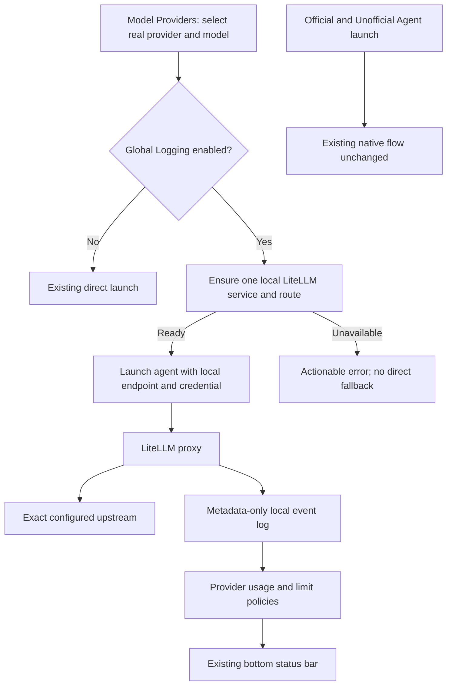

# Local Model Provider observability through LiteLLM

Status: accepted direction; implementation and E2E verification pending.

## Motivation

The existing bottom status bar already shows native usage for Claude, Codex and OpenCode. Custom Model Providers lack a unified usage source: collecting Pi's session logs (and then adding a separate parser for every CLI) would couple the UI to individual clients and miss retries and other HTTP attempts. Kilo's hourly free-request limit is the first concrete use case. The goal is to show the observed provider usage and applicable limit in the existing bottom line, regardless of which supported agent CLI consumes that custom provider.

Use the maintained official [LiteLLM project](https://github.com/BerriAI/litellm) as the local gateway, not the discontinued Rust proof of concept. Do not build a new HTTP proxy, modify/fork Herdr Core or Herdr App, modify LiteLLM, or change agent CLI source. This is a local desktop feature, not a hosted or multi-user gateway.

## Product contract

- A single global **Enable Logging** setting in the existing Model Providers settings page; default off for existing and new installations. No per-provider switch, new settings page or standalone dashboard.
- OFF: existing Model Provider launch behavior and upstream endpoints are unchanged.
- ON: a launch through the **Model Providers** flow uses the exact selected provider and model via one shared local LiteLLM service. The picker continues to show the real provider/model, never LiteLLM as a selectable provider, model or agent. No change to native Official Agents or Unofficial Agents flows, even when the same executable (e.g. Codex or Claude) is selected.
- Logging is metadata only. No prompt, response text, tool inputs, credentials, raw headers or unredacted errors in persistent logs. Do not export telemetry externally.
- Fail closed: when logging is enabled, an unavailable/incompatible gateway prevents the affected new launch with an actionable error. Never silently bypass it or choose another provider/model.
- No automatic retry, fallback, load balancing, semantic cache, or budget enforcement introduced by the gateway. Preserve upstream status/error behavior, streaming, cancellation and tool calling. Existing agent retries remain observable.
- Switching logging applies to new launches; do not kill or silently reroute already-running sessions. The service must remain available for sessions still using it.
- No benchmark, performance regression suite, UI snapshot or screenshot deliverable. Only focused end-to-end functional verification.

## Architecture

Existing integration points to revalidate against main:
- `orca-ui/shared/codex-provider.js`: shared provider launch/config logic, including Pi's temporary provider. Edit shared source and regenerate managed copies with the existing build mechanism.
- `mods/orca-agent-flyout/pi-provider.mjs`: existing Pi endpoint injection.
- `mods/orca-agent-settings/provider-view.js` and `state.js`: settings and persisted global logging flag.
- `mods/orca-status-bar/main.js`, `local-usage.js`, `usage.js`: existing usage display, watched cache and refresh behavior. Preserve existing native usage chips.

Keep the service/lifecycle and route mapping separate from provider usage policies. Reuse the existing Mod/build layout, confirming import and capability boundaries before selecting final files. No new repository or changes to host code.

## Implementation sequence

### 1. Local integration and compatibility

- Pin a tested official stable LiteLLM release; do not require a pure-Rust build. Validate its supported installation mode locally without Docker, Redis or PostgreSQL. Use a dedicated environment, no mutation of system Python; explicit actionable setup if the dependency is missing.
- Start lazily on the first managed launch; ensure a single instance with a process/ownership lock, localhost-only binding, authenticated requests and health/readiness checks. Use an app-owned loopback endpoint and private configuration directory. Reject unexpected listener ownership. Do not expose a general arbitrary upstream proxy.
- Keep the gateway independent of page navigation and mod reloads; avoid terminating active agent sessions when logging is toggled or routes change. If safe in-place config updates are unavailable, explicitly handle pending changes instead of restarting active sessions.
- Derive routes from saved provider IDs and model IDs, not display labels; map collision-free internal aliases back to the original IDs. Preserve user selections, custom base URLs, exact upstream model names and supported authentication including anonymous Kilo if possible. Avoid placing upstream secrets in CLI argv, logs or repository; keep existing credential storage as source of truth.
- Route only the explicit Model Providers launch branch. Support the required CLI wire protocols: Pi OpenAI chat completions, Codex OpenAI Responses, Claude Anthropic Messages. Validate LiteLLM's actual compatibility per supported provider/protocol combination; reject unsupported combinations instead of silently substituting. Do not imply every provider supports every protocol.
- Add the persisted global switch to the existing page; no new UI beyond the switch, errors and bottom-line usage.

### 2. Metadata collection, provider policy and bottom line

- Use a supported LiteLLM callback/extension or equivalent supported local logging interface; do not fork upstream. Verify coverage of the pinned release's Python/Rust paths and SSE failures. If a callback does not cover actual upstream attempts, expose that limitation or use a supported path with adequate coverage; do not claim exact counts.
- Record an allowlisted event schema with version, attempt/request ID, UTC timestamp, configured provider ID, original model ID, outcome/status, optional input/output/cache tokens, optional latency/TTFT, and sanitized error category. Unknown values are null. No request/response payloads. Verify default LiteLLM logging does not persist sensitive data independently.
- Store bounded, rotated local JSONL under the existing usage cache convention (e.g. `~/.cache/herdr-usage/litellm/`), with private permissions. Distinguish attempted upstream calls, successes, 429s and failed local validation; avoid duplicate counting when callbacks fire more than once. Persist through restarts. No DB service.
- First provider policy: Kilo free requests observed in a rolling 60-minute window. Validate the current official free model IDs and quota scope; separate paid requests and 429 observations, do not count local validation failures as upstream calls. The nominal 200/hour limit and rolling window are estimates until authoritative quota/reset semantics are confirmed. Other CLI/device traffic outside this gateway is unobserved. A 429 is not necessarily a quota consumption or even a gateway-specific throttle.
- Render a single Kilo provider chip, for example `~127/200 1h` (illustrative), with clear estimated/local-observation tooltip. Count may exceed the nominal limit; do not clamp the underlying count. Expire requests when idle. Show unknown/unavailable when there is no trustworthy observation, not fabricated 0/200. Keep provider-neutral metadata and allow future policies; without a verified limit, show usage only, not a guessed denominator.
- Reuse existing status bar conventions and icons, and isolate gateway log updates from the existing full provider refresh so a Kilo event does not invoke unrelated Claude/Codex/OpenCode/OMP probes. No additional UI surfaces.

### 3. E2E-only verification

Use a local deterministic mock LLM upstream and real pinned LiteLLM in an isolated temporary environment. Exercise actual launch construction, proxy network traffic, metadata log persistence and the bottom-line reading/rendering contract. No live paid API keys in CI; an optional local real Kilo smoke test can confirm anonymous auth and live limit behavior without intentionally exhausting quota. No screenshots or benchmarks.

Acceptance criteria:
- [ ] Default OFF and toggled OFF retain existing direct endpoint; no service required.
- [ ] ON routes managed Pi/Codex/Claude requests through the same local service to the exact selected upstream/model; prove applicable protocol combinations, streaming, tool calls and cancellation.
- [ ] Native Official/Unofficial launch paths are unchanged, including when executable names match managed launches; LiteLLM is absent from provider/model pickers.
- [ ] Multiple sessions and provider IDs remain isolated and share one gateway; settings reload does not duplicate processes or interrupt active sessions.
- [ ] Local readiness/auth failures and unsupported combinations fail visibly with no direct fallback; reject unauthenticated requests.
- [ ] Mock upstream verifies exactly one upstream attempt per normal request; controlled retries/fallbacks disabled; 429 and failures propagated/recorded without misclassifying local failures.
- [ ] Metadata-only files contain no fixture prompts, responses, credentials, tool arguments or sensitive headers/errors.
- [ ] Kilo free/paid distinction, duplicate callbacks, expiry at the 60-minute boundary, concurrent sessions and app/service restart produce correct observed counts; unknown limit/coverage not misrepresented.
- [ ] Bottom line consumes the new provider policy while preserving native usage sources and avoiding unrelated refreshes.
- [ ] No benchmark workflow, UI snapshot or changes to host repositories.

## Open implementation questions (resolve in E2E, not product decisions)

- Which stable LiteLLM release and supported callback mode covers actual upstream attempts with all three wire protocols, without external databases?
- Can LiteLLM update routes without interrupting active streams? If not, use a safe deferred configuration policy.
- How does Kilo expose free model metadata, anonymous authentication and quota/reset headers? Keep usage explicitly estimated until verified.
- Confirm the existing Herdr process and capability interfaces can supervise the local service without host modifications.

References: [LiteLLM docs](https://docs.litellm.ai/), [official Rust migration tracking issue](https://github.com/BerriAI/litellm/issues/31263), [Kilo gateway docs](https://kilo.ai/docs/).

This design is a planning baseline, not a claim that integration or E2E tests have passed.
