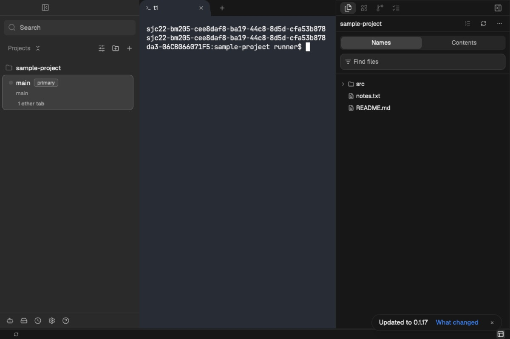
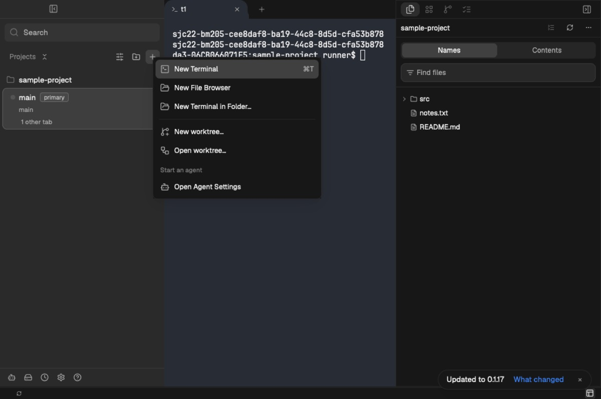
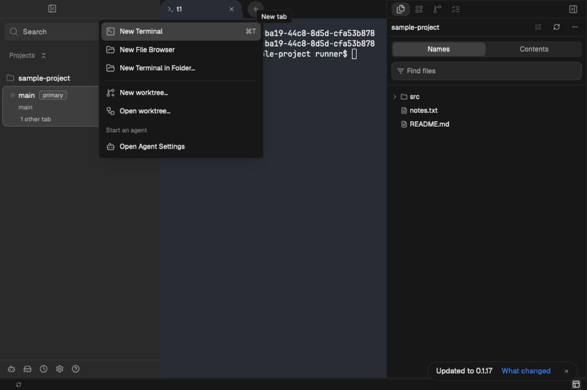

# Latest custom Orca mod interactions

Main commit: **7ae666940da5636d6a5715f37789e6f39550f007**

Native App screenshots from a synthetic workspace on a disposable GitHub-hosted runner.
Full-resolution originals, before/after pairs, and machine-readable diagnostics remain in the Actions artifact.

[Open this Actions run / full artifact](https://github.com/TonyPythoneer/herdr-my-orca/actions/runs/45367963624)

Tracked configuration files verified after native launch: 612

captured: 2 · failed: 18 · blocked: 5 · not-run: 0

Only custom controls. Captured means a real interaction and visible change; semantic review is required. Closed frames show the actual Escape key interaction.

## Mod coverage

Observed: orca-nav, orca-new-menu

Not observed: agent-config, orca-agent-manager, orca-agents, orca-changes, orca-chrome, orca-confirm, orca-diff, orca-files, orca-float, orca-handoff, orca-landing, orca-menu, orca-pane, orca-panel-gap, orca-panel-head, orca-spaces, orca-split-menu, orca-status, orca-tabs, orca-tasks, orca-worktree

## 01 — orca-nav: Workspace options popup

**captured** · native-mouse · expected-popup

**Before**

**After**

**Closed**

## 02 — orca-nav / orca-new-menu: New workspace menu

**captured** · native-mouse · expected-popup

**Before**

**After**

**Closed**

## 03 — orca-nav / orca-spaces: Collapse project groups

**blocked** · not-attempted · not verified

Incomplete operation; consult manifest.json in the full artifact.

## 04 — orca-nav / orca-spaces: Expand project groups

**blocked** · not-attempted · not verified

Incomplete operation; consult manifest.json in the full artifact.

## 05 — orca-spaces: Project group disclosure

**blocked** · not-attempted · not verified

Incomplete operation; consult manifest.json in the full artifact.

## 06 — orca-spaces: Project group expand

**blocked** · not-attempted · not verified

Incomplete operation; consult manifest.json in the full artifact.

## 07 — orca-spaces / orca-menu: Project group menu

**blocked** · not-attempted · not verified

Incomplete operation; consult manifest.json in the full artifact.

## 08 — orca-tabs / orca-new-menu: New terminal tab menu

**failed** · native-mouse · expected-popup

Incomplete operation; consult manifest.json in the full artifact.

**Before**

**After**

**Diagnostic**

## 09 — orca-files: Explorer: expand src folder

**failed** · not-attempted · not verified

Incomplete operation; consult manifest.json in the full artifact.

## 10 — orca-files: Explorer: select Contents search

**failed** · not-attempted · not verified

Incomplete operation; consult manifest.json in the full artifact.

## 11 — orca-files: Explorer: search details

**failed** · not-attempted · not verified

Incomplete operation; consult manifest.json in the full artifact.

## 12 — orca-files: Explorer: return to Names search

**failed** · not-attempted · not verified

Incomplete operation; consult manifest.json in the full artifact.

## 13 — orca-files: Explorer: open file

**failed** · not-attempted · not verified

Incomplete operation; consult manifest.json in the full artifact.

## 14 — orca-panel-head / orca-changes: Source Control tab

**failed** · not-attempted · not verified

Incomplete operation; consult manifest.json in the full artifact.

## 15 — orca-changes / orca-diff: Source Control: open changed file

**failed** · not-attempted · not verified

Incomplete operation; consult manifest.json in the full artifact.

## 16 — orca-panel-head / orca-agents: Agent history tab

**failed** · not-attempted · not verified

Incomplete operation; consult manifest.json in the full artifact.

## 17 — orca-chrome / orca-agent-manager: Agent manager footer

**failed** · not-attempted · not verified

Incomplete operation; consult manifest.json in the full artifact.

## 18 — orca-chrome / orca-agent-manager: Model providers footer

**failed** · not-attempted · not verified

Incomplete operation; consult manifest.json in the full artifact.

## 19 — orca-agent-manager: Agent manager: global permissions dropdown

**failed** · not-attempted · not verified

Incomplete operation; consult manifest.json in the full artifact.

## 20 — orca-agent-manager: Agent manager: provider editor

**failed** · not-attempted · not verified

Incomplete operation; consult manifest.json in the full artifact.

## 21 — orca-chrome / orca-tasks: Task management footer

**failed** · not-attempted · not verified

Incomplete operation; consult manifest.json in the full artifact.

## 22 — orca-tasks: Task management: JSON editor

**failed** · not-attempted · not verified

Incomplete operation; consult manifest.json in the full artifact.

## 23 — orca-tasks: Task management: back to terminals

**failed** · not-attempted · not verified

Incomplete operation; consult manifest.json in the full artifact.

## 24 — orca-chrome / orca-tabs: Unified sidebar collapse

**failed** · not-attempted · not verified

Incomplete operation; consult manifest.json in the full artifact.

## 25 — orca-panel-head / orca-tabs: Unified right panel collapse

**failed** · not-attempted · not verified

Incomplete operation; consult manifest.json in the full artifact.

