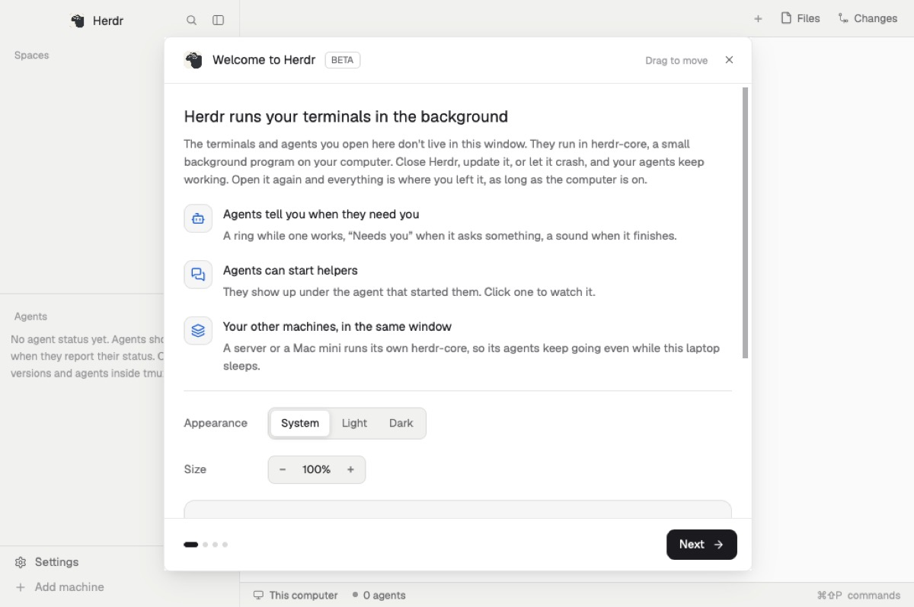

# Latest main UI snapshot

Main commit: **734f3066dd85d10093b293bb2df7477750b0c4dc**

Native App screenshots from a synthetic workspace on a disposable GitHub-hosted runner.
Full-resolution originals, before/after pairs, and machine-readable diagnostics remain in the Actions artifact.

[Open this Actions run / full artifact](https://github.com/TonyPythoneer/herdr-my-orca/actions/runs/45362483215)

captured: 1 · failed: 1 · blocked: 0 · not-run: 44

Command navigation and actual accessibility/mouse operations are labeled separately. Captured does not mean visually validated.

## 01 — First launch

**captured** · initial-state

**After**

## 02 — Dismiss startup overlay if present

**failed** · native-command+mouse

Incomplete operation; consult manifest.json in the full artifact.

**Before**

**Diagnostic**

## 03 — Switch to Orca layout

**not-run** · native-command

Incomplete operation; consult manifest.json in the full artifact.

## 04 — Welcome / landing page

**not-run** · native-command

Incomplete operation; consult manifest.json in the full artifact.

## 05 — Create fixture workspace

**not-run** · native-command

Incomplete operation; consult manifest.json in the full artifact.

## 06 — Show terminal

**not-run** · native-command

Incomplete operation; consult manifest.json in the full artifact.

## 07 — Create second tab

**not-run** · native-command

Incomplete operation; consult manifest.json in the full artifact.

## 08 — Rename selected tab

**not-run** · native-command

Incomplete operation; consult manifest.json in the full artifact.

## 09 — Switch to first tab

**not-run** · native-command

Incomplete operation; consult manifest.json in the full artifact.

## 10 — Split right

**not-run** · native-command

Incomplete operation; consult manifest.json in the full artifact.

## 11 — Split down

**not-run** · native-command

Incomplete operation; consult manifest.json in the full artifact.

## 12 — Zoom focused pane

**not-run** · native-command

Incomplete operation; consult manifest.json in the full artifact.

## 13 — Restore split panes

**not-run** · native-command

Incomplete operation; consult manifest.json in the full artifact.

## 14 — Close focused pane

**not-run** · native-command

Incomplete operation; consult manifest.json in the full artifact.

## 15 — Collapse left sidebar

**not-run** · native-command

Incomplete operation; consult manifest.json in the full artifact.

## 16 — Expand left sidebar

**not-run** · native-command

Incomplete operation; consult manifest.json in the full artifact.

## 17 — Collapse right sidebar

**not-run** · native-command

Incomplete operation; consult manifest.json in the full artifact.

## 18 — Expand right sidebar

**not-run** · native-command

Incomplete operation; consult manifest.json in the full artifact.

## 19 — Right panel: files

**not-run** · native-command

Incomplete operation; consult manifest.json in the full artifact.

## 20 — Right panel: changes

**not-run** · native-command

Incomplete operation; consult manifest.json in the full artifact.

## 21 — Right panel: ports

**not-run** · native-command

Incomplete operation; consult manifest.json in the full artifact.

## 22 — Right panel: vault

**not-run** · native-command

Incomplete operation; consult manifest.json in the full artifact.

## 23 — Right panel: workspaces

**not-run** · native-command

Incomplete operation; consult manifest.json in the full artifact.

## 24 — Right panel: pr-checks

**not-run** · native-command

Incomplete operation; consult manifest.json in the full artifact.

## 25 — Right panel: checks

**not-run** · native-command

Incomplete operation; consult manifest.json in the full artifact.

## 26 — Search files

**not-run** · native-command

Incomplete operation; consult manifest.json in the full artifact.

## 27 — Open new-tab menu

**not-run** · native-command

Incomplete operation; consult manifest.json in the full artifact.

## 28 — Dismiss new-tab menu

**not-run** · native-command

Incomplete operation; consult manifest.json in the full artifact.

## 29 — Open split menu

**not-run** · native-command

Incomplete operation; consult manifest.json in the full artifact.

## 30 — Dismiss split menu

**not-run** · native-command

Incomplete operation; consult manifest.json in the full artifact.

## 31 — Agent manager

**not-run** · native-command

Incomplete operation; consult manifest.json in the full artifact.

## 32 — Model providers

**not-run** · native-command

Incomplete operation; consult manifest.json in the full artifact.

## 33 — Tasks

**not-run** · native-command

Incomplete operation; consult manifest.json in the full artifact.

## 34 — Return to terminals

**not-run** · native-command

Incomplete operation; consult manifest.json in the full artifact.

## 35 — Workspace search (actual AX press)

**not-run** · accessibility-press

Incomplete operation; consult manifest.json in the full artifact.

## 36 — Dismiss search

**not-run** · native-command

Incomplete operation; consult manifest.json in the full artifact.

## 37 — Workspace options (actual AX press)

**not-run** · accessibility-press

Incomplete operation; consult manifest.json in the full artifact.

## 38 — Dismiss options

**not-run** · native-command

Incomplete operation; consult manifest.json in the full artifact.

## 39 — Agents footer (actual AX press)

**not-run** · accessibility-press

Incomplete operation; consult manifest.json in the full artifact.

## 40 — Providers footer (actual AX press)

**not-run** · accessibility-press

Incomplete operation; consult manifest.json in the full artifact.

## 41 — Tasks footer (actual AX press)

**not-run** · accessibility-press

Incomplete operation; consult manifest.json in the full artifact.

## 42 — Switch unified layout

**not-run** · native-command

Incomplete operation; consult manifest.json in the full artifact.

## 43 — Unified layout sidebar animation settled

**not-run** · native-command

Incomplete operation; consult manifest.json in the full artifact.

## 44 — Unified layout sidebar restored

**not-run** · native-command

Incomplete operation; consult manifest.json in the full artifact.

## 45 — Unified layout right panel animation settled

**not-run** · native-command

Incomplete operation; consult manifest.json in the full artifact.

## 46 — Unified layout right panel restored

**not-run** · native-command

Incomplete operation; consult manifest.json in the full artifact.

