# Latest custom Orca mod interactions

Main commit: **9912b690041cf4fa79fe999baa9394aeba0f778b**

Native App screenshots from a synthetic workspace on a disposable GitHub-hosted runner.
Full-resolution originals, before/after pairs, and machine-readable diagnostics remain in the Actions artifact.

[Open this Actions run / full artifact](https://github.com/TonyPythoneer/herdr-my-orca/actions/runs/45371638810)

Tracked configuration files verified after native launch: 612

captured: 24 · failed: 1 · blocked: 0 · not-run: 0

Only custom controls. Captured means a real interaction and visible change; semantic review is required. Closed frames show actual Escape or outside click, as indicated per operation.

## Mod coverage

Observed: orca-agent-manager, orca-agents, orca-changes, orca-chrome, orca-diff, orca-files, orca-menu, orca-nav, orca-new-menu, orca-panel-head, orca-spaces, orca-tabs, orca-tasks

Not observed: agent-config, orca-confirm, orca-float, orca-handoff, orca-landing, orca-pane, orca-panel-gap, orca-split-menu, orca-status, orca-worktree

## 01 — orca-nav: Workspace options popup

**captured** · native-mouse · expected-popup

Dismissal: native-keyboard-escape

Click: [204, 97]

**Before**

**After**

**Closed**

## 02 — orca-nav / orca-new-menu: New workspace menu

**captured** · native-mouse · expected-popup

Dismissal: native-keyboard-escape

Click: [260, 97]

**Before**

**After**

**Closed**

## 03 — orca-nav / orca-spaces: Collapse project groups

**captured** · native-mouse · visible-change; manual semantic review required

Click: [76, 97]

**Before**

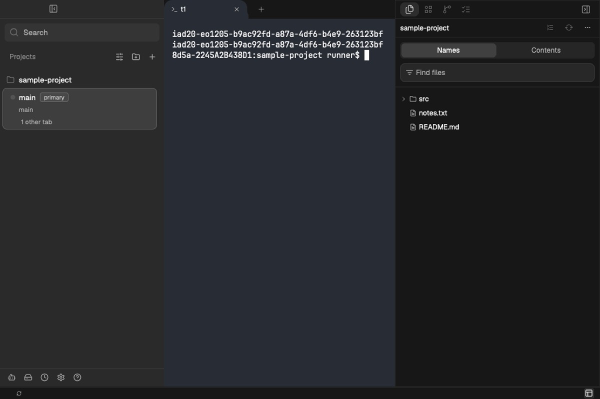

**After**

## 04 — orca-nav / orca-spaces: Expand project groups

**captured** · native-mouse · visible-change; manual semantic review required

Click: [76, 97]

**Before**

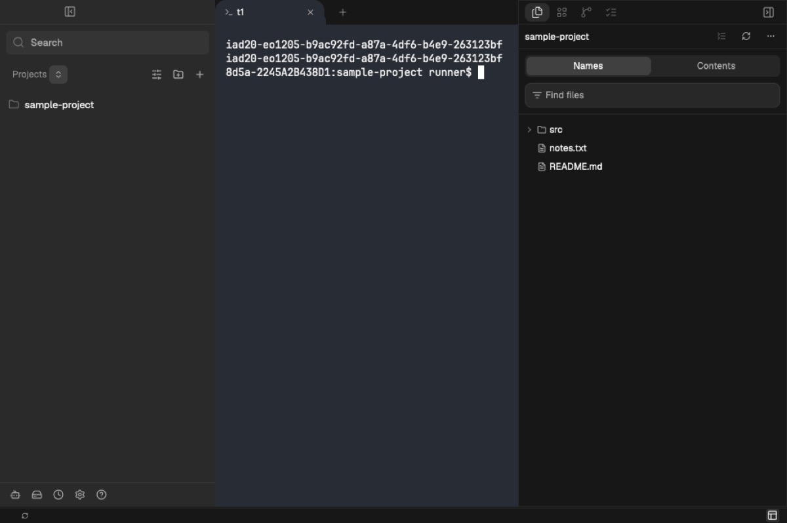

**After**

## 05 — orca-spaces: Project group disclosure

**captured** · native-mouse · visible-change; manual semantic review required

Click: [92, 136]

**Before**

**After**

## 06 — orca-spaces: Project group expand

**captured** · native-mouse · visible-change; manual semantic review required

Click: [92, 136]

**Before**

**After**

## 07 — orca-spaces / orca-menu: Project group context menu

**captured** · native-mouse · expected-popup

Dismissal: native-keyboard-escape

Click: [92, 136]

**Before**

**After**

**Closed**

## 08 — orca-tabs / orca-new-menu: New terminal tab menu

**captured** · native-mouse · expected-popup

Dismissal: native-keyboard-escape

Click: [446, 16]

**Before**

**After**

**Closed**

## 09 — orca-files: Explorer: expand src folder

**captured** · native-mouse · visible-change; manual semantic review required

Click: [716, 168]

**Before**

**After**

## 10 — orca-files: Explorer: select Contents search

**captured** · native-mouse · visible-change; manual semantic review required

Click: [930, 86]

**Before**

**After**

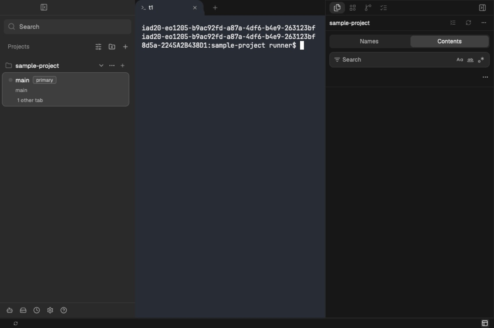

## 11 — orca-files: Explorer: search details

**captured** · native-mouse · visible-change; manual semantic review required

Click: [1005, 160]

**Before**

**After**

## 12 — orca-files: Explorer: return to Names search

**captured** · native-mouse · visible-change; manual semantic review required

Click: [765, 86]

**Before**

**After**

## 13 — orca-files: Explorer: open file

**captured** · native-mouse · visible-change; manual semantic review required

Click: [751, 216]

**Before**

**After**

## 14 — orca-panel-head / orca-changes: Source Control tab

**captured** · native-mouse · visible-change; manual semantic review required

Click: [763, 16]

**Before**

**After**

## 15 — orca-changes / orca-diff: Source Control: open changed file

**captured** · native-mouse · visible-change; manual semantic review required

Dismissal: native-outside-click

Click: [749, 178]

**Before**

**After**

**Closed**

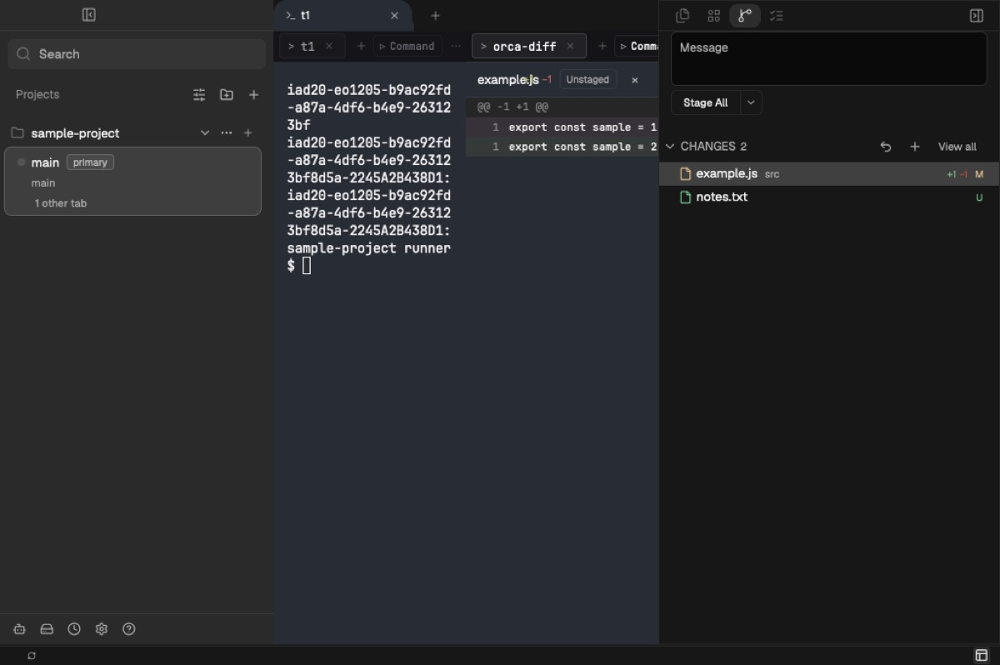

## 16 — orca-panel-head / orca-agents: Agent history tab

**captured** · native-mouse · visible-change; manual semantic review required

Click: [731, 16]

**Before**

**After**

## 17 — orca-chrome / orca-agent-manager: Agent manager footer

**captured** · native-mouse · visible-change; manual semantic review required

Click: [20, 645]

**Before**

**After**

## 18 — orca-chrome / orca-agent-manager: Model providers footer

**captured** · native-mouse · visible-change; manual semantic review required

Click: [48, 645]

**Before**

**After**

## 19 — orca-agent-manager: Agent manager: global permissions dropdown

**captured** · native-mouse · visible-change; manual semantic review required

Dismissal: native-outside-click

Click: [550, 140]

**Before**

**After**

**Closed**

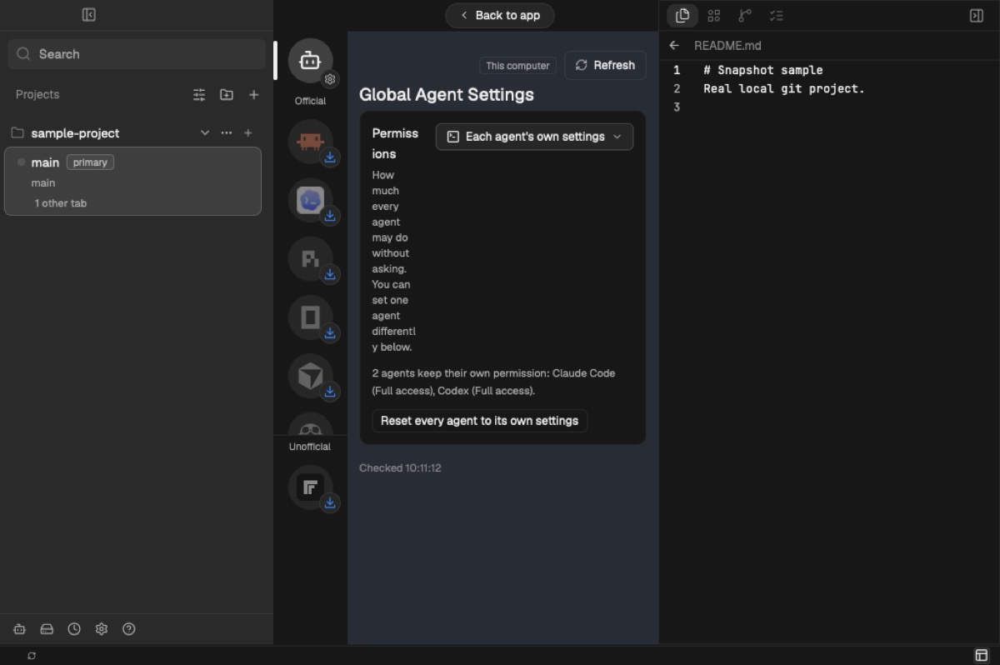

## 20 — orca-agent-manager: Agent manager: provider editor

**captured** · accessibility-press · visible-change; manual semantic review required

**Before**

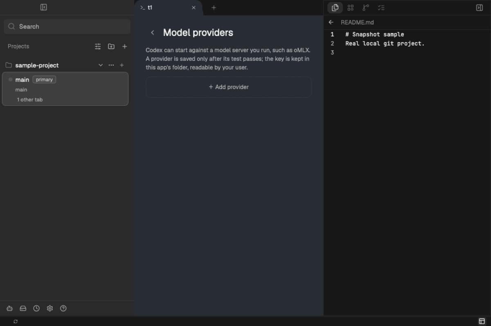

**After**

## 21 — orca-chrome / orca-tasks: Task management footer

**captured** · native-mouse · visible-change; manual semantic review required

Click: [76, 645]

**Before**

**After**

## 22 — orca-tasks: Task management: JSON editor

**failed** · native-mouse · not verified

Click: [612, 271]

Isolation recovery: succeeded

Incomplete operation; consult manifest.json in the full artifact.

**Before**

**After**

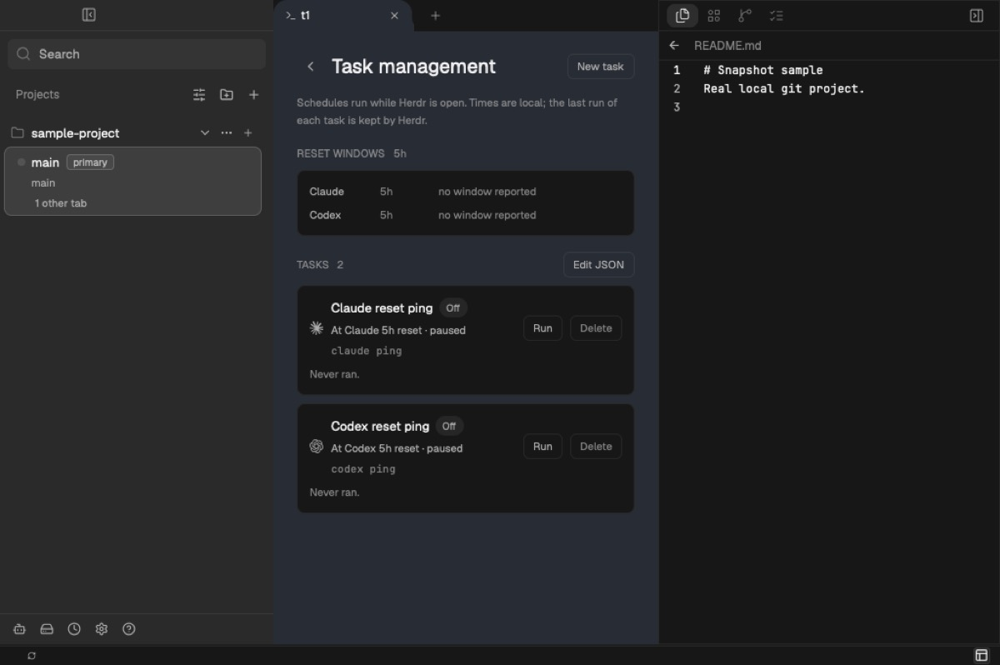

**Diagnostic**

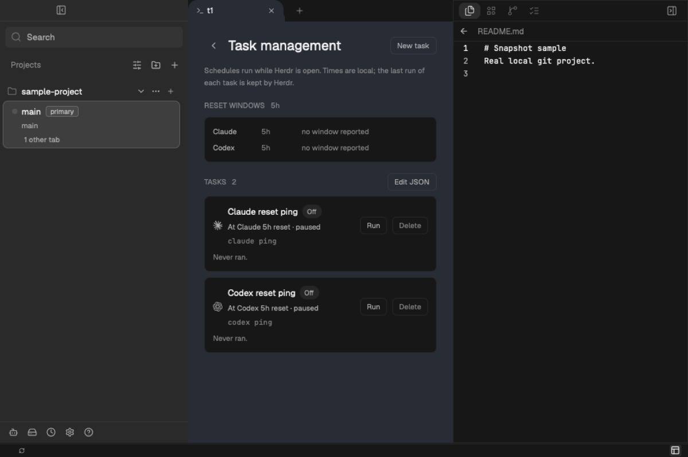

## 23 — orca-tasks: Task management: back to terminals

**captured** · native-mouse · visible-change; manual semantic review required

Click: [318, 68]

**Before**

**After**

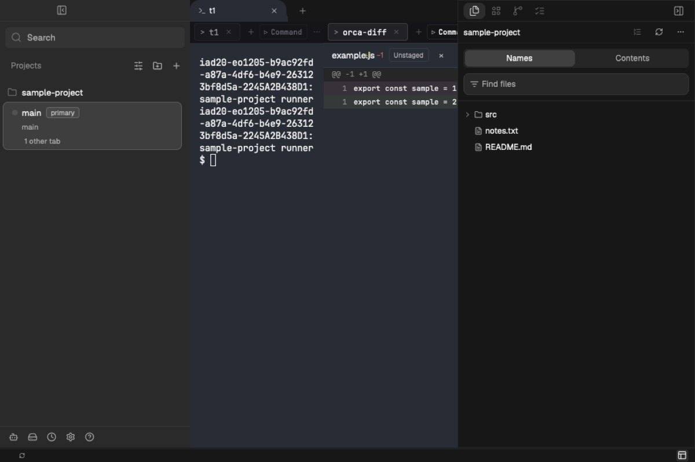

## 24 — orca-chrome / orca-tabs: Unified sidebar collapse

**captured** · native-mouse · visible-change; manual semantic review required

Click: [91, 15]

**Before**

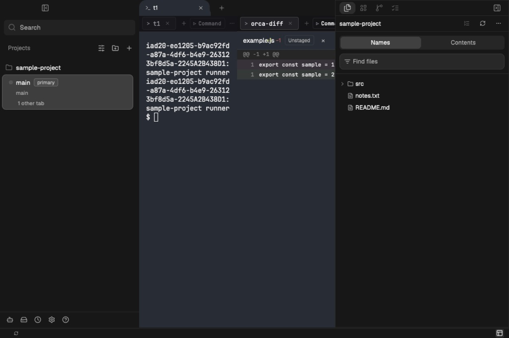

**After**

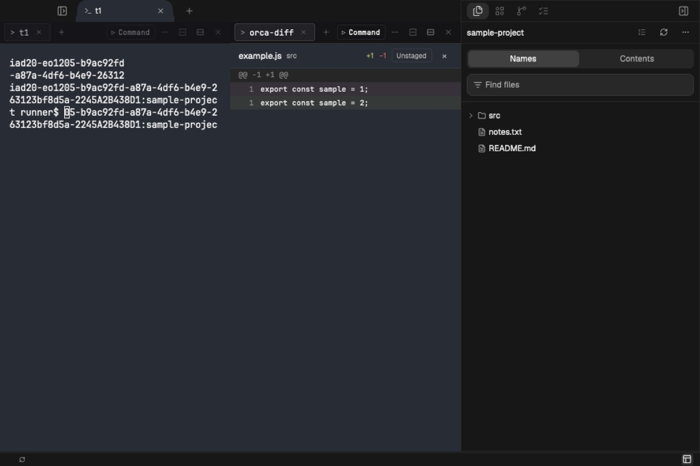

## 25 — orca-panel-head / orca-tabs: Unified right panel collapse

**captured** · native-mouse · visible-change; manual semantic review required

Click: [1000, 15]

**Before**

**After**

